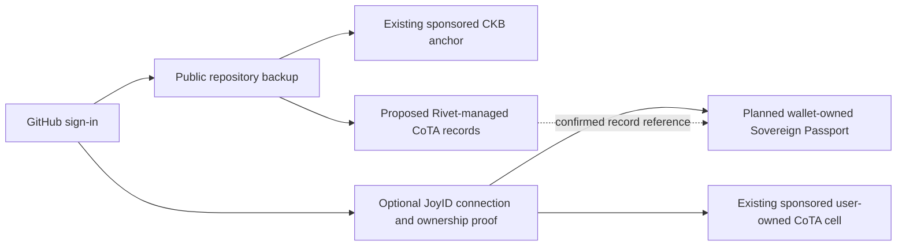

# Sponsored CoTA onboarding: working architecture

This note translates the shared developer conversation into implementation boundaries. The product direction is GitHub-first onboarding, Rivet-funded initial usage, and optional JoyID ownership and passport features. The separate Rivet-managed proof tree below is a candidate implementation for that direction, not a description of the existing deployment or a completed funded deliverable.

The subsequent [identity delivery recommendation](./IDENTITY_DELIVERY_DECISION.md) recommends retaining user-owned CoTA storage through a supported manifest representation and keeping the hosted tree below as an experiment. It records the ownership decision, verification requirements, publication recovery and the live gates that remain.

## Product flow

1. A developer signs in with GitHub and backs up public repositories without connecting a wallet or buying CKB. Rivet funds the existing backup anchors and transaction fees.
2. In the proposed hosted stage, Rivet publishes developer and public-backup commitments in a Rivet-managed CoTA tree. GitHub users have distinct record namespaces, and can export evidence of their records' inclusion in the confirmed root. Rivet controls this tree's signing key; these are service attestations, not signatures from the developer's wallet.
3. The developer can choose **Connect Wallet**, create/connect JoyID through its normal passkey interaction, and prove ownership. Keep the existing verified wallet linking and sponsored user-owned CoTA registration.
4. A later owner-approved proof or Sovereign Passport can reference the earlier confirmed records. A personal CoTA cell and a passport have their own ownership and capacity requirements; owning either must be verified explicitly.

The existing agreed adjustment still applies: the user's personal CoTA cell is created after optional wallet connection. GitHub OAuth alone does not silently establish a user-controlled JoyID account. Sponsored funding and wallet ownership are separate properties. Paying CKB alone does not add a recovery mechanism or establish stronger security.



## Separate the three CoTA roles

| Component | Controller and purpose | Status |
| --- | --- | --- |
| CoTA global registry | Protocol registration of addresses, ensuring one CoTA cell per address. It is not Rivet's developer/backup record tree. | Used by existing sponsored registration. |
| Rivet-managed application CoTA cell | Rivet signs custom identity/public-backup SMT updates; initial usage can happen without user wallet interaction. | Isolated local contract prototype; no production API or automatic publishing enabled. |
| JoyID-owned personal CoTA cell | The connected wallet controls its own CoTA state, including supported wallet features and assets. | Sponsored registration and signed-witness proofs confirmed; custom `rivet1` SMT updates remain incompatible. |

The [CoTA overview](https://www.cotadev.io/docs/protocols/cota_main) defines the root and owner-bound type arguments. The [registry specification](https://www.cotadev.io/docs/protocols/cota_registry) describes address registration. The [transaction rules](https://www.cotadev.io/docs/protocols/cota_witness) prohibit transferring an existing CoTA cell and require its type arguments to match the owner lock hash. A Rivet-controlled CoTA cell cannot simply be relocked to JoyID as an upgrade. Any later ownership transition needs a separate owner-approved attestation, supported asset transfer, or a separately validated migration protocol.

## Why this avoids the hosted-stage failure

The deployed CoTA type accepts the custom `rivet1` extension, while the deployed JoyID lock rejects it with error 16 in the current generated-passkey regression. A separate application CoTA cell under a standard CKB secp256k1 lock can be tested independently. The user does not need that signing key; Rivet operates the hosted tree and pays its fees.

This separates application publishing from JoyID authorization. It does not repair the incompatible JoyID-owned update. Existing JoyID registrations, confirmed witness proofs, and the preserved failed attempt remain valid historical records and must not be replaced by the hosted prototype.

## Record and publication requirements

- Namespace keys by immutable GitHub ID, record kind, and repository identifier. The existing per-user key `commitmentKey('developer')` cannot be shared across accounts. Use an unambiguous versioned encoding of those components, and do not identify accounts by mutable GitHub usernames.
- Bind each public record to its GitHub account, repository, confirmed backup outpoint, Merkle root, and CID as applicable. A wallet association is added only after verified ownership; it must not be inferred from GitHub authentication.
- Retain the records, canonical commitment encoding, inclusion proofs, source outpoint, signed transaction, and confirmed root so verification can be performed without trusting Rivet's current database. Mark the publisher as Rivet; do not label this an owner-signed proof.
- Persist the full tree and pending signed attempt, reconcile the source cell/root before updates, and serialize consume-and-replace transactions. Retrying a signed update must reuse it. An update for one user must preserve all other users' leaves.
- Continue the testnet restriction to public repositories and exclude credentials/encryption keys. Publishing a hash does not make witness record contents private.
- The current `buildSmt` supports at most 128 leaves and the extension builder reconstructs the known tree. That is a bounded prototype, not an implementation suitable for an unbounded shared user population. Durable state, limits or partitioning, and proof generation need a production design before rollout.
- A dedicated application signing identity should be separate from personal wallets. Its live registration, funding, configuration, and automatic publishing are separate deployment work; the offline test uses generated keys only.

## Verification and remaining decisions

The isolated contract test should prove an initial empty-tree update and a subsequent update against both the deployed CoTA type and standard secp lock. It must preserve a second user's record, reject an incorrect root/proof and invalid signature, and keep the output lock/type unchanged. This checks the storage mechanism; it does not demonstrate hosted API authentication, production persistence, registration, or a live wallet ownership transition.

October 27, 2026 local result: 16 tests passed with none skipped, covering the new hosted-tree contract test plus the existing JoyID contract, SMT, and sponsored registration tests. Initial publication and a later update pass both the deployed CoTA type and standard secp lock. Updating one user's records preserves the other user's entries. An incorrect root, corrupted signature, and proof omitting the other user's existing state are rejected by the corresponding script. The existing JoyID custom-extension failure remains reproduced; its signed-witness alternative still passes. No live registration or update was broadcast.

To reconstruct public dependencies and run the isolated check from the repository root:

```sh
pnpm --filter @proof/web run cota:fixture --include-secp --output /tmp/rivet-sponsored-cota-fixture.json
RIVET_CKB_DEBUGGER=/path/to/ckb-debugger \
RIVET_CKB_FIXTURE=/tmp/rivet-sponsored-cota-fixture.json \
pnpm --filter @proof/web exec tsx --test tests/cota-hosted-contract.test.cjs tests/identity-proof-contract.test.cjs tests/cota-smt.test.cjs
```

Use an official [CKB debugger release](https://github.com/nervosnetwork/ckb-standalone-debugger/releases) and verify its checksum. The fixture command refuses to overwrite an existing file. Its `--include-secp` option adds public standard-lock dependencies to the simulation fixture; it does not modify the chain transaction. The contract tests simulate an already registered cell with generated keys and never use the real sponsor key or broadcast a transaction. Without the debugger/fixture environment variables, contract tests are skipped and must not be reported as verified.

Before enabling the candidate, implement authenticated record publication, durable/retry-safe tree state, downloadable inclusion proofs, and explicit UI descriptions of hosted versus wallet-approved records. Then demonstrate GitHub-only backup, optional JoyID reconnect, no duplicate subsidy, and owner-approved references to the hosted proof. The passport remains separate unfinished work.

The funded checklist currently promises identity and backup records in the user's CoTA SMT. A Rivet-managed shared tree changes that ownership/storage arrangement. Keep that item open and record the proposed difference explicitly; hosted contract validation alone does not complete Milestone 1. The screenshots motivate the onboarding goals but do not constitute protocol confirmation or an amendment to the funded acceptance criteria.
